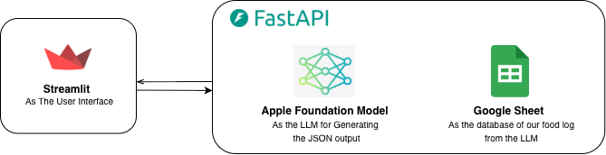

# 🥗 AI Meal Tracker (Polisi Makan)

Aplikasi pelacak makanan berbasis AI yang berjalan **lokal**. Upload foto piring makananmu, lalu AI akan mengenali menu, bahan-bahan, perkiraan berat, dan memberi **peringatan** kalau makananmu mengandung **gorengan** atau **santan**. Semua hasil otomatis di-log ke Google Sheets dan bisa dilihat sebagai laporan mingguan.

## ✨ Fitur

- 📷 **Upload & analisis foto makanan** (JPG, PNG, HEIC)
- 🧠 **Deteksi komponen makanan** (nama menu, tag cara masak, bahan, estimasi gram) menggunakan Apple Foundation Model
- 🚨 **Rule engine "Polisi Makan"**: alert otomatis untuk gorengan (minyak jenuh) dan santan (kolesterol jenuh)
- 📝 **Auto-log ke Google Sheets** sebagai database riwayat makan
- 📊 **Weekly analytics**: ringkasan 7 hari terakhir, grafik harian gorengan vs santan, dan tabel riwayat

## 🏗️ Arsitektur



| Komponen | Peran |
|---|---|
| **Streamlit** | User interface (upload foto, tampilkan hasil, dashboard analytics) |
| **FastAPI** | Backend API lokal yang mengatur alur analisis, rule engine, dan logging |
| **Apple Foundation Model** | LLM (via `fm` CLI) untuk membaca gambar dan menghasilkan output JSON |
| **Google Sheets** | Database untuk food log hasil analisis LLM |

### Alur kerja

1. User upload foto di Streamlit.
2. Streamlit mengirim file ke `POST /analyze` di FastAPI.
3. FastAPI menyimpan file sementara, lalu menjalankan `fm respond --image ... --text <prompt>`.
4. Output JSON dari model dibersihkan dan divalidasi (Pydantic), lalu dicek oleh rule engine (gorengan / santan).
5. Hasil di-append ke Google Sheets dan dikembalikan ke Streamlit.
6. Tab **Weekly Analytics** membaca langsung dari Google Sheets untuk membuat grafik dan metrik.

## 🛠️ Tech Stack

- **Frontend:** Streamlit, Plotly, Pandas
- **Backend:** FastAPI, Uvicorn, Pydantic
- **AI:** Apple Foundation Model (`fm` CLI)
- **Storage:** Google Sheets (`gspread`, `oauth2client`)
- **Image:** Pillow, `pillow-heif` (dukungan HEIC dari iPhone)

## 📋 Prasyarat

- Mac dengan **Apple Intelligence** aktif dan **`fm` CLI** terpasang (pastikan perintah `fm respond` bisa dijalankan di terminal)
- Python 3.10+
- Akun Google dengan **Service Account** (file `credentials.json`)

## 🚀 Instalasi

```bash
# 1. Clone repo
git clone <url-repo-kamu>
cd <nama-folder-project>

# 2. Buat virtual environment
python -m venv venv
source venv/bin/activate

# 3. Install dependencies
pip install -r requirements.txt
```

### `requirements.txt`

```txt
fastapi
uvicorn
pydantic
gspread
oauth2client
python-multipart
streamlit
requests
pandas
plotly
pillow-heif
```

## 🔑 Setup Google Sheets

1. Buka [Google Cloud Console](https://console.cloud.google.com/), buat project, lalu aktifkan **Google Sheets API** dan **Google Drive API**.
2. Buat **Service Account**, lalu download key-nya dalam format JSON dan simpan sebagai `credentials.json` di root project.
3. Buat Google Spreadsheet dengan judul **`Food Tracking Assistant`** dan worksheet bernama **`Sheet1`**.
4. **Share** spreadsheet tersebut ke email service account (`...@...iam.gserviceaccount.com`) dengan akses **Editor**.
5. Isi baris pertama (header) dengan urutan kolom berikut:

| A | B | C | D | E | F |
|---|---|---|---|---|---|
| `Timestamp` | `menu_name` | `preparation_tag` | `Has Fried` | `Has Santan` | `raw_json` |

### Environment variables (opsional)

| Variable | Default | Keterangan |
|---|---|---|
| `GOOGLE_CREDENTIALS_PATH` | `credentials.json` | Lokasi file credentials service account |
| `GOOGLE_SHEETS_NAME` | `Food Tracking Assistant` | Nama spreadsheet yang dipakai backend |

> ⚠️ **Jangan commit `credentials.json` ke Git.** Tambahkan ke `.gitignore`.

## ▶️ Menjalankan Aplikasi

Jalankan backend dan frontend di dua terminal terpisah.

**Terminal 1: FastAPI backend**

```bash
uvicorn main:app --reload --port 8000
```

**Terminal 2: Streamlit frontend**

```bash
streamlit run app.py
```

Lalu buka `http://localhost:8501`. Kalau backend jalan di alamat lain, ubah **API Base URL** di sidebar (default: `http://localhost:8000`).

> Sesuaikan `main.py` dan `app.py` dengan nama file di project kamu.

## 🔌 API Reference

### `GET /`
Health check.

```json
{ "status": "ok", "engine": "Apple Foundation Model (afm) Local API" }
```

### `POST /analyze`
Menganalisis foto makanan.

- **Body:** `multipart/form-data` dengan field `file` (gambar)
- **Contoh:**

```bash
curl -X POST http://localhost:8000/analyze \
  -F "file=@nasi_padang.jpg"
```

- **Response:**

```json
{
  "menu_name": "Nasi Padang",
  "preparation_tags": ["fried", "coconut-milk"],
  "ingredients": [
    {
      "ingredient": "Rendang",
      "amount_grams": 100,
      "is_fried": false,
      "contains_santan": true
    }
  ],
  "has_fried": false,
  "has_santan": true,
  "warning_message": "🚨 **SANTAN DETECTED:** Hati-hati kolesterol jenuh!"
}
```

## 📁 Struktur Project

```
.
├── app.py              # Streamlit UI (upload & weekly analytics)
├── main.py             # FastAPI backend (analisis, rule engine, logging)
├── credentials.json    # Service account Google (JANGAN di-commit)
├── architecture.png    # Diagram arsitektur
├── requirements.txt
└── README.md
```

## 🧪 Rule Engine

| Kondisi | Peringatan |
|---|---|
| Ada bahan `is_fried = true` | 🚨 **GORENGAN DETECTED:** Minyak jenuh tinggi! |
| Ada bahan `contains_santan = true` | 🚨 **SANTAN DETECTED:** Hati-hati kolesterol jenuh! |
| Tidak ada keduanya | ✅ Safe meal! |

## 🩹 Troubleshooting

- **`Failed to process image with fm CLI`**: pastikan `fm` terpasang, Apple Intelligence aktif, dan perintah `fm respond` jalan manual di terminal.
- **`Gagal koneksi ke API`**: cek apakah FastAPI sudah jalan dan **API Base URL** di sidebar sudah benar.
- **Data tidak masuk ke Sheets**: cek apakah spreadsheet sudah di-share ke email service account dan path `credentials.json` benar. Error logging Sheets hanya tampil sebagai warning di log backend.
- **`Error parse sheet`** di tab analytics: pastikan header sheet sesuai dengan 6 kolom di atas.

## ⚠️ Disclaimer

Estimasi bahan dan berat berasal dari output model AI dan **bukan pengganti saran ahli gizi atau dokter**.

## 📄 Lisensi

Tambahkan lisensi sesuai kebutuhan (misalnya MIT).
